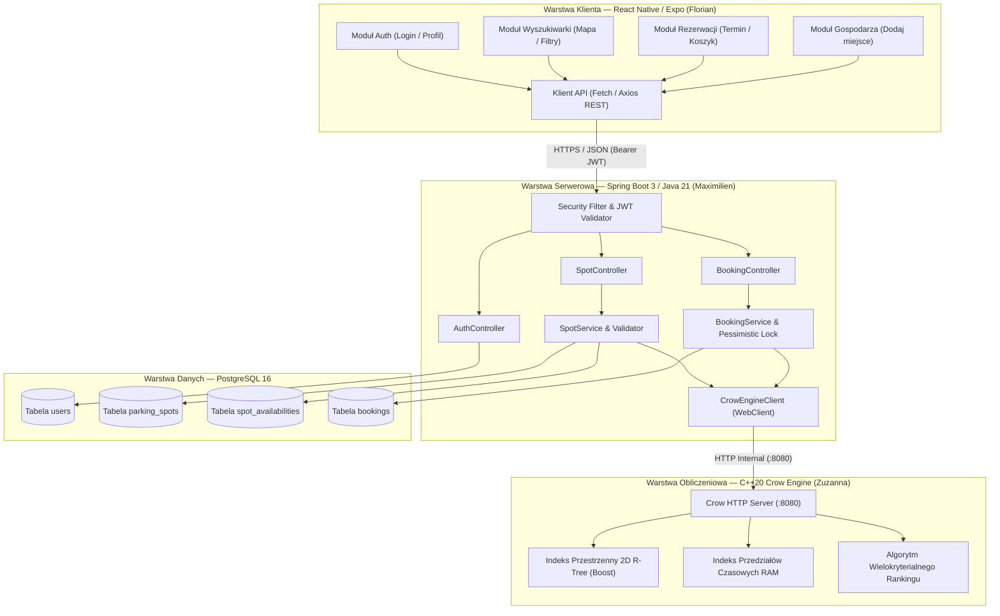
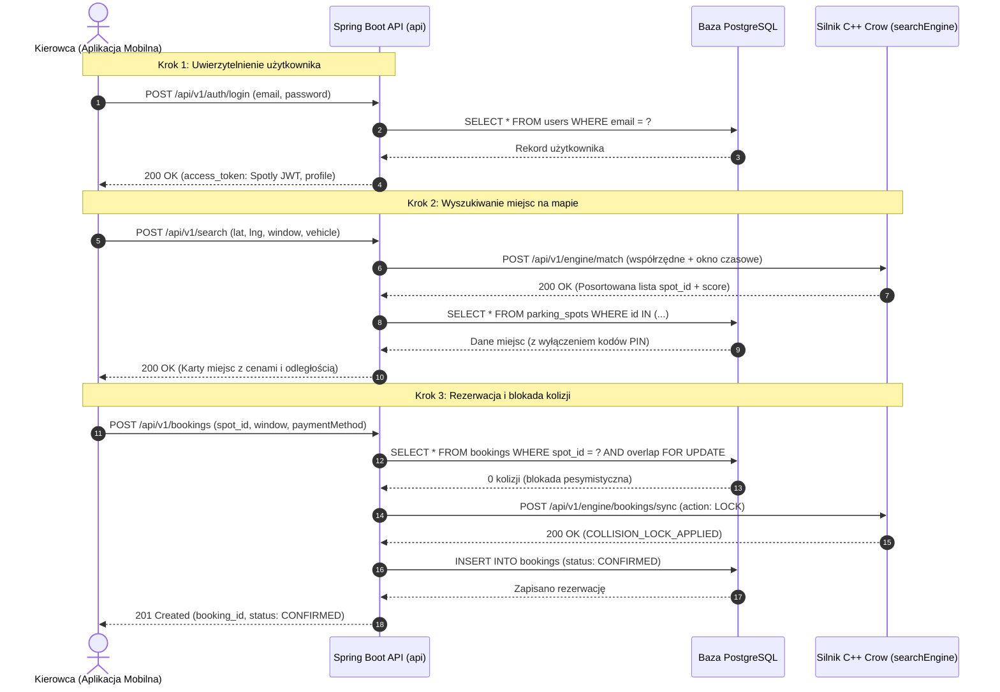
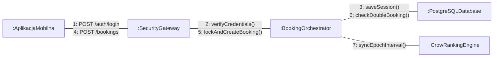
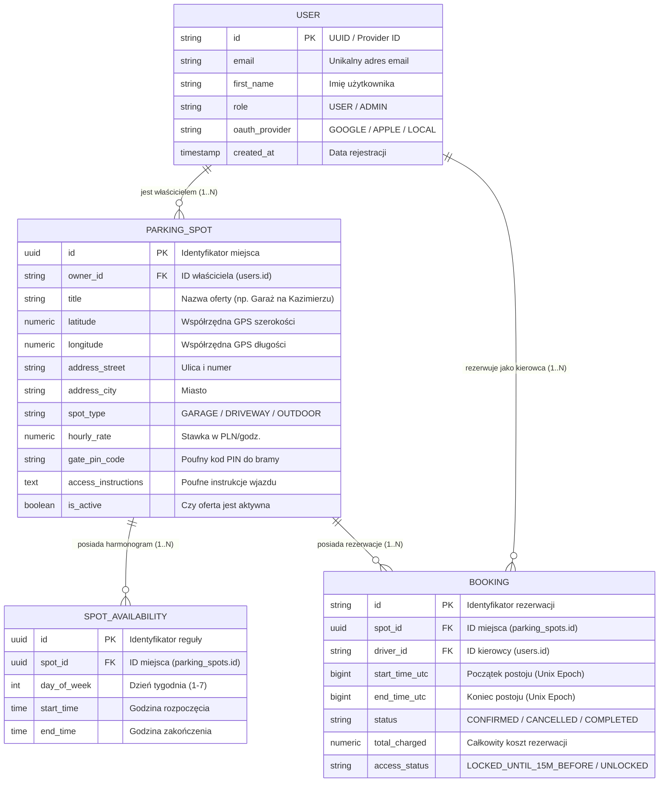
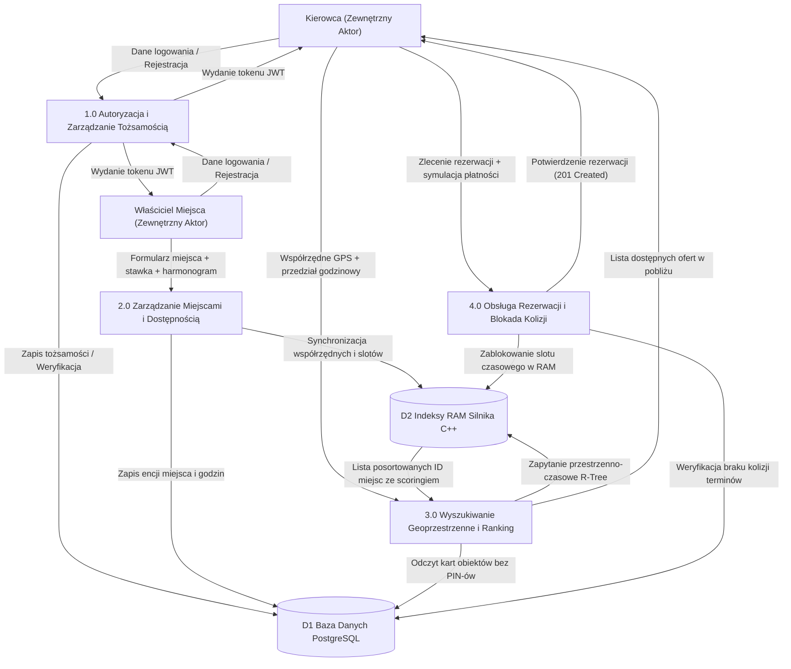

# Spotly – Architektura Systemu (Model 4+1)

Niniejszy dokument opisuje architekturę systemu **Spotly** (mobilna platforma P2P współdzielenia miejsc parkingowych) zgodnie ze standardem **Modelu 4+1 Kruchtena** (Architectural View Model).

---

## 1. Widok Scenariuszy / Przypadków Użycia (Use Case View)

Widok ten łączy pozostałe perspektywy i bazuje na opracowanych wymaganiach funkcjonalnych oraz historiach użytkownika:
* **US-00:** Bezpieczne uwierzytelnienie użytkownika w aplikacji (Email / Hasło, Google Sign-In) i utworzenie sesji JWT.
* **US-01:** Definiowanie dostępności i stawki godzinowej miejsca przez właściciela.
* **US-02:** Wyszukiwanie miejsc parkingowych według lokalizacji i okna czasowego.
* **US-03:** Sortowanie i scoring ofert (cena, odległość, typ pojazdu).
* **US-04:** Rezerwacja miejsca parkingowego i transakcyjna blokada kolizji terminów.
* **US-05:** Odblokowanie poufnych instrukcji wjazdu (kod PIN do bramy) ściśle na 15 minut przed rozpoczęciem postoju.

Szczegółowa specyfikacja wymagań znajduje się w [`.specify/spec.md`](file:///Users/floriankurpiela/Desktop/STUDIA/Spotlly/.specify/spec.md) oraz [`docs/requirements.md`](file:///Users/floriankurpiela/Desktop/STUDIA/Spotlly/docs/requirements.md).

---

## 2. Widok Deweloperski / Struktury (UML Component Diagram)

Poniższy diagram komponentów przedstawia dekompozycję modularną systemu, wykorzystane technologie oraz interfejsy komunikacyjne:

---

## 3. Widok Procesu (Process View)

### A. Diagram Sekwencji UML (Sequence Diagram) — Logowanie i rezerwacja
Poniższy diagram sekwencji obrazuje interakcję w czasie pomiędzy aplikacją mobilną, backendem, silnikiem C++ oraz bazą danych:

### B. Diagram Komunikacji UML (Communication Diagram)
Diagram komunikacji kładzie nacisk na powiązania strukturalne obiektów w trakcie realizacji rezerwacji i autoryzacji:

Numery komunikatów:
* `1:` Klient przesyła dane logowania do bramy bezpieczeństwa.
* `2:` Brama weryfikuje dane uwierzytelniające w orkiestratorze.
* `3:` Zapis i weryfikacja tożsamości użytkownika w relacyjnej bazie danych.
* `4:` Uwierzytelniony klient zleca rezerwację slotu parkingowego.
* `5:` Orkiestrator przetwarza wniosek rezerwacyjny i inicjuje blokadę transakcyjną.
* `6:` Baza danych PostgreSQL wykonuje zapytanie z blokadą wierszy, eliminując ryzyko kolizji.
* `7:` Zsynchronizowanie zajętości w pamięci RAM silnika C++ (aktualizacja `activeBookings`).

---

## 4. Diagramy Danych (Data View)

### A. Diagram Modelu Danych (ERD — Entity Relationship Diagram)
Model relacyjny wdrożony w PostgreSQL 16 za pośrednictwem migracji Flyway (`V1__init_schema.sql`):

### B. Diagram Przepływu Danych (DFD — Data Flow Diagram, Poziom 1)
Diagram DFD przedstawia przepływ danych pomiędzy podmiotami zewnętrznymi, procesami a magazynami danych:

---

## 5. Widok Fizyczny / Wdrożeniowy (Deployment View)

System wdrażany jest w postaci kontenerów Docker za pośrednictwem pliku `docker-compose.yml`:
* **Kontener `spotly-postgres`:** PostgreSQL 16 z wolumenem `spotly_postgres_data` na porcie `5432`.
* **Kontener `spotly-api`:** Spring Boot 3 (Java 21) na porcie `8081`.
* **Kontener `spotly-search-engine`:** Mikrousługa C++20 Crow na porcie `8080` w wewnętrznej sieci Dockerowej (`api_default`).
* **Środowisko Klienckie:** Aplikacja React Native (Expo) uruchamiana na urządzeniach mobilnych użytkowników (iOS/Android).
