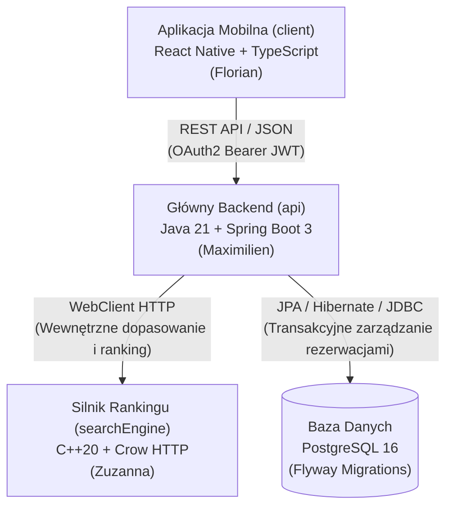
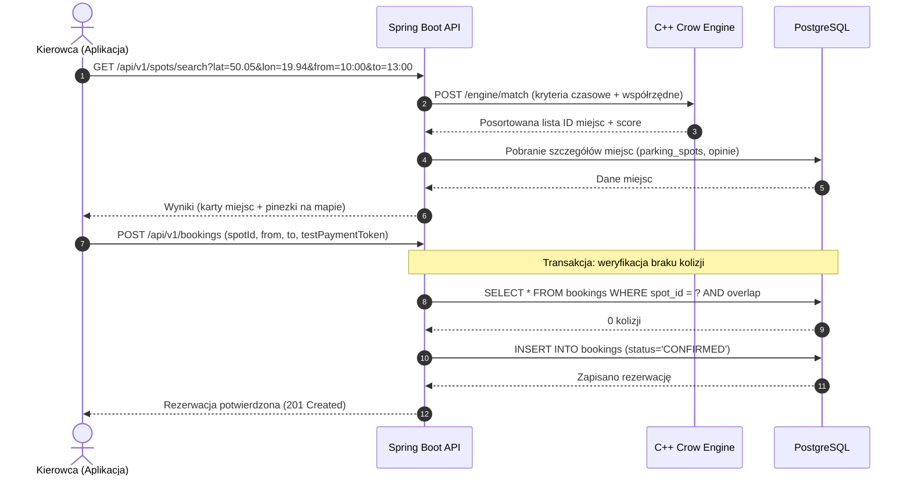

# Spotly – Architektura Systemu (docs/architecture.md)

Niniejszy dokument opisuje strukturę architektoniczną systemu **Spotly**, model komunikacji pomiędzy modułami, bezpieczeństwo danych oraz specyfikację technologiczną.

---

## 1. Przegląd komponentów

System składa się z trzech odrębnych komponentów aplikacyjnych oraz relacyjnej bazy danych:

### Podstawowe zasady architektury:
1. **Separacja odpowiedzialności:** Frontend (`client`) komunikuje się wyłącznie z bramą API (`api` w Javie). Frontend **nigdy** nie odpytuje bezpośrednio bazy danych ani silnika C++.
2. **Bezpieczeństwo rezerwacji i unikanie kolizji:** Za transakcyjną spójność rezerwacji (brak nakładania się terminów dla tego samego miejsca) odpowiada Spring Boot w połączeniu z transakcjami PostgreSQL (izolacja transakcji i blokady optymistyczne/pesymistyczne), a nie wyłącznie silnik C++.
3. **Wydajność wyszukiwania:** Silnik C++ (`searchEngine`) służy do intensywnych obliczeniowo operacji przestrzenno-czasowych (geoprzestrzenne filtrowanie promienia, ranking ofert według wag, dopasowywanie okien dostępności).

---

## 2. Szczegółowy opis modułów

### A. Moduł Mobilny (`client/`)
* **Technologia:** React Native (Expo SDK, TypeScript).
* **Odpowiedzialny:** Florian Kurpiela.
* **Główne zadania:**
  * Interfejs użytkownika zoptymalizowany pod kątem wygody kierowcy i gospodarza.
  * Trzy główne ekrany procesu:
    1. *Ekran Wyszukiwania:* Interaktywna mapa z kafelkami cenowymi, geolokalizacja, filtry czasu i budżetu.
    2. *Ekran Rezerwacji:* Karta obiektu, galeria zdjęć, wybór przedziału czasowego, kalkulator opłat, symulacja płatności.
    3. *Ekran Dodawania:* Formularz udostępniania miejsca (adres, kategoria, stawka/h, zdjęcia).
  * Uwierzytelnianie użytkownika: Google / Apple Sign-In z przekazaniem tokenu ID do API.

### B. Moduł Backendowy (`api/`)
* **Technologia:** Java 21, Spring Boot 3.3.x, Spring Data JPA, Spring Security (OAuth2 Resource Server), Flyway, Springdoc OpenAPI.
* **Odpowiedzialny:** Maximilien Klima.
* **Główne zadania:**
  * Weryfikacja tożsamości i autoryzacja żądań użytkowników.
  * Logika biznesowa rezerwacji i blokowanie kolidujących przedziałów czasowych.
  * Walidacja stawek, danych wejściowych i zarządzanie cyklem życia rezerwacji (`PENDING`, `CONFIRMED`, `CANCELLED`, `COMPLETED`).
  * Udostępnianie dokumentacji REST API (Swagger / OpenAPI pod `/swagger-ui.html`).
  * Pośrednictwo i orkiestracja zapytań do silnika C++.

### C. Silnik Wyszukiwania i Rankingu (`searchEngine/`)
* **Technologia:** C++20, framework mikrousług Crow HTTP.
* **Odpowiedzialna:** Zuzanna Kot.
* **Główne zadania:**
  * Szybkie algorytmy przeszukiwania dostępności w pamięci RAM.
  * Sortowanie i scoring ofert na podstawie wielu wag (cena, odległość, ocena gospodarza, rodzaj miejsca).
  * Spełnienie celu wydajnościowego: czas odpowiedzi $p95 < 50\text{ ms}$.
  * Testy odpornościowe: fuzz testing z użyciem libFuzzer oraz GoogleTest.

### D. Warstwa Danych (PostgreSQL)
* **Wersja:** PostgreSQL 16 (konteneryzacja Docker Compose).
* **Zarządzanie schematem:** Migracje Flyway (`V1__init_schema.sql`).
* **Kluczowe tabele:**
  * `users` – tożsamość kierowców i właścicieli.
  * `parking_spots` – metadane miejsca (adres, typ, lokalizacja GPS, opis, cena bazowa).
  * `spot_availabilities` – zdefiniowane okna czasowe udostępnienia.
  * `bookings` – zarejestrowane rezerwacje wraz ze statusem i kosztami.

---

## 3. Diagram sekwencji – Przepływ wyszukiwania i rezerwacji

